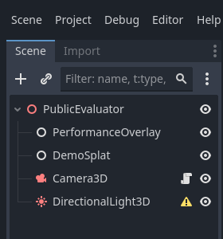
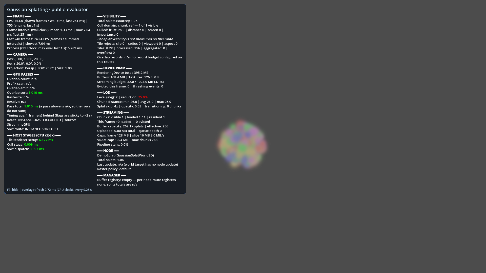

# Your First Splat

**For:** Godot users trying godotGS for the first time.

**At the end:** you have the sample project open in a godotGS editor, a splat on screen, and you know where to go to bring in your own capture.

Follow the four steps below. First run the supplied sample, then import your own capture.

## 1. Get an Editor

A stock Godot editor does not work: you need an editor built from this fork.

- **Windows or Linux:** download a nightly editor from [Downloads](downloads.md). On Windows, take `godotgs-windows-x86_64-<tag>.zip`, not the export template zip.
- **macOS:** there is no published binary. Build one with [Build from Source](../BUILDING.md), then come back to step 2.
- **Already built one?** Any editor built from this fork works. [Build Your Own Editor](installation.md) lists the prerequisites.

This page shows that godotGS works, not how fast it is. The Linux nightly is not built for speed; the [Performance Dashboard](../performance/index.md) shows what an optimized build measures.

## 2. Get the Sample Project

The sample project lives in this repository, not in the nightly archive. A shallow clone is enough and much quicker than the full engine history:

```bash
git clone --depth 1 https://github.com/klausi3D/godotGS.git
cd godotGS
```

Run the commands in the next steps from the root of that clone.

## 3. Open the Project in Your Editor

Set `GODOT_BINARY` to the absolute path of your editor, then open the sample project:

```bash
export GODOT_BINARY=/absolute/path/to/godot.linuxbsd.editor.dev.x86_64
$GODOT_BINARY -e --path tests/examples/godot/test_project
```

```powershell
$env:GODOT_BINARY="C:\absolute\path\to\godot.windows.editor.x86_64.exe"
& $env:GODOT_BINARY -e --path .\tests\examples\godot\test_project
```

The sample project opens in the editor. Keep the `-e` flag: without it, `--path` runs the project's main scene directly instead of opening the editor.

You can also start the editor normally and import `tests/examples/godot/test_project` from the Project Manager.

In the FileSystem dock, expand `scenes` and open `public_evaluator.tscn`. The Scene dock should show `PublicEvaluator`, with `PerformanceOverlay`, `DemoSplat`, `Camera3D` and `DirectionalLight3D` underneath it.

<figure class="gs-tutorial-shot" markdown="1">
{ .gs-shot .gs-shot--natural width="280" height="300" loading="lazy" }
<figcaption markdown="span">The sample scene open in the editor. Check these node names before pressing Play. [Capture details](../reference/index.md#first-splat-captures).</figcaption>
</figure>

## 4. Press Play

Press Play (F5). The project's main scene, `res://scenes/public_evaluator.tscn`, shows a small synthetic sample: a 1,024-splat test fixture, not a real capture.

You should see:

- splats in the viewport, lit by the scene's directional light;
- a performance overlay with frame rate and timings (F3 hides it).

The camera is a fly camera: the mouse looks around, `W` `A` `S` `D` move, `E` or `Space` goes up, `Q` goes down, and `Shift` moves faster. `Esc` quits.

<figure class="gs-tutorial-shot" markdown="1">
{ .gs-shot width="1920" height="1080" loading="lazy" }
<figcaption markdown="span">The supplied 1,024-splat fixture after pressing Play. The timing overlay belongs to this tiny sample; use the [Performance Dashboard](../performance/index.md) for benchmark results. [Capture details](../reference/index.md#first-splat-captures).</figcaption>
</figure>

If nothing appears, or the splats are black, go to [Troubleshooting](../troubleshooting/index.md).

## Next: Import Your Own Capture

Copy a `.ply` or `.spz` source file into your project's folder. The editor imports it as a splat asset (`GaussianSplatAsset`). Drag that splat asset into the 3D viewport and the editor creates a `GaussianSplatNode3D` that draws it. The [Import Workflow](../workflows/importing.md) covers the supported formats and what to do when an import fails.

<figure markdown="1">
{ .gs-shot width="1280" height="720" loading="lazy" }
<figcaption markdown="span">A real capture in the editor, after import: the Mip-NeRF 360 "garden" scene (5.8M splats) drawn by a selected `GaussianSplatNode3D`, in a project made from the repository's project template. This is not the step 4 sample. Scan: Barron et al., [CC BY 4.0](https://creativecommons.org/licenses/by/4.0/), trained with gsplat by the godotGS project. Editor: godotGS built from [PR #1226](https://github.com/klausi3D/godotGS/pull/1226), RTX 3090. Not the default settings: black background, scene light off, tile cap 65,536, Custom quality (shown in the Inspector). See [Image credits](../reference/index.md#image-credits).</figcaption>
</figure>

## Where to Go Next

- [Guides](../user/index.md): concepts, quality presets, lighting and the feature guides.
- [Known Public Alpha Limitations](../development/known-public-alpha-limitations.md): what this alpha ships with, and the workarounds.
- [Export Templates](../development/export-templates.md): before you export a game.
- [Compatibility Matrix](../reference/compatibility-matrix.md): what is tested on which platform.

## Optional: Check an Editor You Built

Optional check, useful for an editor you built yourself: open the project headlessly and quit. It should exit without errors.

```bash
$GODOT_BINARY --headless --path tests/examples/godot/test_project --quit
```

```powershell
& $env:GODOT_BINARY --headless --path .\tests\examples\godot\test_project --quit
```

## Ready to Continue {#flow-reference}

You are ready to import your own capture when the sample renders and the camera controls work.
